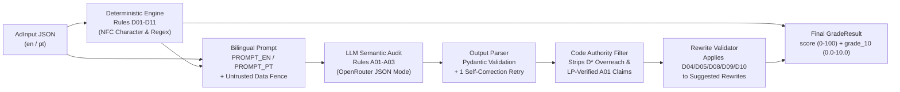

# Ad Copy Grader — Hybrid Google Ads RSA Auditor

> **[🇺🇸 English](README.md) | [🇧🇷 Português](README.pt-BR.md)**

A stateless **FastAPI + Pydantic v2** service and interactive web playground that audits **Google Ads Responsive Search Ads (RSAs)** using a **hybrid deterministic + LLM architecture**. Exact character counts, structural constraints, and policy patterns (`D01–D11`) are enforced by deterministic Python code, while semantic cross-checks against the Landing Page (`A01–A03`) are evaluated by an LLM (`google/gemini-2.5-flash` via OpenRouter) and post-filtered by a **Server Code Authority Filter** that blocks LLM hallucinations and validates every rewrite suggestion before returning a **0.0–10.0 Quality Grade (`grade_10`)**.

---

## Live Links & Documentation

- **Interactive Web Playground (GitHub Pages):** `https://fgm9000.github.io/ad-copy-grader/` *(or open `web/index.html` locally)*
- **Live Cloud Run API & Swagger UI:** `https://ad-copy-grader-316736391681.us-central1.run.app/docs` *(root `/` automatically redirects to `/docs`)*
- **Product Requirements Document (PRD):** [English](docs/prd.md) | [Português](docs/prd.pt-BR.md)
- **Architecture & Cloud Run WIF Setup Guide:** [English](docs/architecture.md) | [Português](docs/architecture.pt-BR.md)
- **Cloud Run Deployment & Troubleshooting Runbook:** [English](docs/deployment-runbook.md) | [Português](docs/deployment-runbook.pt-BR.md)
- **Architecture Decision Records (ADRs):**
  - [ADR-001: Python 3.12, FastAPI, Pydantic v2, and `uv`](docs/decisions/001-python-fastapi-pydantic-v2.md) ([PT-BR](docs/decisions/001-python-fastapi-pydantic-v2.pt-BR.md))
  - [ADR-002: Hybrid Deterministic Code + LLM Authority Pipeline](docs/decisions/002-hybrid-deterministic-llm-authority.md) ([PT-BR](docs/decisions/002-hybrid-deterministic-llm-authority.pt-BR.md))
  - [ADR-003: Single-Instance Cloud Run (`max-instances=1`) & Keyless OIDC WIF](docs/decisions/003-cloud-run-single-instance-wif.md) ([PT-BR](docs/decisions/003-cloud-run-single-instance-wif.pt-BR.md))
  - [ADR-004: Three-Column Promptfoo Evaluation Design](docs/decisions/004-three-column-promptfoo-evals.md) ([PT-BR](docs/decisions/004-three-column-promptfoo-evals.pt-BR.md))
  - [ADR-005: Pre-Compiled Tailwind CSS Static Web Playground](docs/decisions/005-zero-runtime-tailwind-static-demo.md) ([PT-BR](docs/decisions/005-zero-runtime-tailwind-static-demo.pt-BR.md))

---

## Hybrid Pipeline Architecture



1. **Deterministic First (`rules.py`):** Evaluates 11 exact structural and editorial rules (`D01–D11`) over NFC-normalized strings. LLMs are notoriously unreliable at counting characters (`30` for headlines, `90` for descriptions, `15` for paths); Python code is 100% exact.
2. **Bilingual Semantic Audit (`prompt.py`, `llm.py`, `parser.py`):** Selects the native prompt (`PROMPT_EN` or `PROMPT_PT`), isolates ad copy inside `<ad_payload>` tags as untrusted data to defend against prompt injection, and validates the response via Pydantic with a single automatic self-correction retry if the JSON or `rules_checked` array is malformed.
3. **Server Code Authority Filter (`pipeline.py`):**
   - Drops any `D*` rule ID emitted by the LLM (preventing duplicate or hallucinated length flags).
   - Drops out-of-bounds asset locations.
   - Suppresses `A01` false positives when the flagged price/discount token (e.g., `$899` or `R$ 390`) or generic scheduling CTA actually exists in `lp_context`.
4. **Rewrite Validation (`rewrite.py`):** Every LLM-suggested headline or description rewrite is audited against deterministic rules (`D04`, `D05`, `D08`, `D09`, `D10`). Suggestions that exceed character limits or introduce policy violations are discarded and counted in `discarded_suggestions_count`.
5. **Graceful Degradation:** If the upstream LLM times out or fails twice, `/v1/grade` still returns `HTTP 200` (unless `strict_llm=true` is requested) with the deterministic audit (`D01–D11`), `model: null`, and a localized `degraded_reason`.

---

## Audit Rule Catalog (`D01–D11` & `A01–A03`)

| ID | Rule | Authority | Severity | Impact |
| :--- | :--- | :--- | :--- | :--- |
| **`D01`** | Headline count `< 3` or `> 15` | Deterministic Code | `error` | `-15 pts` |
| **`D02`** | Recommended headline coverage (`< 15` headlines provided) | Deterministic Code | `warning` | `-5 pts` |
| **`D03`** | Description count `< 2` or `> 4` | Deterministic Code | `error` | `-15 pts` |
| **`D04`** | Headline length `> 30` characters (NFC) | Deterministic Code | `error` | `-15 pts` |
| **`D05`** | Description length `> 90` characters (NFC) | Deterministic Code | `error` | `-15 pts` |
| **`D06`** | `path1` or `path2` length `> 15` characters | Deterministic Code | `error` | `-15 pts` |
| **`D07`** | Primary service (`primary_service`) absent from top 5 headlines | Deterministic Code | `warning` | `-5 pts` |
| **`D08`** | Duplicate headlines (case/space-normalized) | Deterministic Code | `error` | `-15 pts` |
| **`D09`** | Prohibited punctuation (`!!`, `??`, `!...`) | Deterministic Code | `error` | `-15 pts` |
| **`D10`** | Excessive ALL CAPS word (`>= 4` letters, outside allowlisted acronyms) | Deterministic Code | `warning` | `-5 pts` |
| **`D11`** | Final URL is missing, malformed, or not HTTPS | Deterministic Code | `error` | `-15 pts` |
| **`A01`** | Concrete price, discount, or offer absent from `lp_context` | LLM + Code Filter | `error` | `-15 pts` |
| **`A02`** | No description contains a clear Call-to-Action (CTA) | LLM + Code Filter | `warning` | `-5 pts` |
| **`A03`** | Absolute clinical/financial outcome guarantee (e.g., `"100% guaranteed"`) | LLM + Code Filter | `warning` | `-5 pts` |

**Scoring Formula:**
- `score = max(0, 100 - 15 * errors - 5 * warnings)` (`0` to `100`)
- `grade_10 = round(score / 10, 1)` (`0.0` to `10.0`, aligned with Google Ads' Quality Score scale)
- `passed = (errors == 0)`

---

## 3-Column Promptfoo Evaluation (`evals/`)

The evaluation suite in [`evals/`](evals/) compares three columns side by side across **16 bilingual single-mutation scenarios** (8 in English, 8 in Portuguese):

| Column | Provider Mode | Purpose | Offline CI (`FAKE_MODEL=1`) |
| :--- | :--- | :--- | :--- |
| **1. Raw LLM** | `mode: raw` | Raw model JSON output before deterministic rules or server authority filtering | **16 / 16 (100%)** |
| **2. Production Hybrid Pipeline** | `mode: pipeline` | Full production pipeline (`D01–D11` + `A01–A03` + Code Authority Filter + Rewrite Validator) | **16 / 16 (100%)** |
| **3. Degraded Prompt** | `mode: degraded` | Ablation baseline removing the prompt guardrail against reporting `D*` rules | Demonstrates `D04` overreach without guardrail |

---

## Engineering Quality Ratchet & AppSec Gates

Every push and pull request is validated by [`.github/workflows/ci.yml`](.github/workflows/ci.yml) and [`.github/workflows/codeql.yml`](.github/workflows/codeql.yml):

| Gate | Tool | Current Baseline ([`quality-baseline.json`](quality-baseline.json)) |
| :--- | :--- | :--- |
| **Lint & Formatting** | `ruff check .` + `ruff format --check .` (`E,F,I,B,UP,S,N,SIM`) | `0` problems |
| **Strict Static Typing** | `mypy --strict` | `0` errors |
| **Unit & Integration Suite** | `pytest --cov=ad_copy_grader` | `123` passed, `0` skipped, **`99.1%`** coverage |
| **Zero-Suppression Ratchet** | `scripts/quality_check.py` (`# noqa`, `# type: ignore`, `pragma: no cover`) | `0` suppressions |
| **SAST (OWASP Top 10 & FastAPI)** | `semgrep scan --config p/owasp-top-ten --config p/python --config p/fastapi --error` | Blocking CI gate |
| **Semantic Taint Analysis** | GitHub CodeQL (`security-extended,security-and-quality`) | Active on `push`, `PR`, and weekly cron |
| **Secret Scanning** | `gitleaks` (full git history + pre-commit hook) | `0` leaks |
| **Dependency Audit (SCA)** | `pip-audit` + weekly Dependabot updates | Monitored in CI |

---

## Quickstart (Local Development)

### Prerequisites
- **Python 3.12+** and **[`uv`](https://docs.astral.sh/uv/)**
- **Node.js 20+** *(optional, only required to run the Promptfoo CLI)*

### 1. Install Dependencies & Git Hooks
```bash
uv sync --frozen
git config core.hooksPath .githooks
```

### 2. Run Tests, Typecheck, Linter & Quality Ratchet
```bash
uv run ruff check .
uv run ruff format --check .
uv run mypy
uv run pytest --cov=ad_copy_grader --cov-report=term-missing
uv run python scripts/quality_check.py
```

### 3. Run the 3-Column Promptfoo Evaluation Suite
```bash
# Offline deterministic CI evaluation (zero cost, no API key required):
FAKE_MODEL=1 uv run npx --yes promptfoo@0.109.0 eval -c evals/promptfooconfig.yaml --no-cache

# Live evaluation against OpenRouter:
OPENROUTER_API_KEY="sk-or-v1-..." LLM_MODEL="google/gemini-2.5-flash" \
  uv run npx --yes promptfoo@0.109.0 eval -c evals/promptfooconfig.yaml --no-cache
```

### 4. Run the FastAPI Server & Web Playground
```bash
# Start in offline FakeModel mode (or set OPENROUTER_API_KEY in .env for live LLM calls):
FAKE_MODEL=true uv run uvicorn ad_copy_grader.api:app --reload --port 8000
```
Open `http://localhost:8000/docs` for the interactive OpenAPI documentation, or serve `web/` (`python -m http.server 3000 -d web`) and visit `http://localhost:3000` to use the bilingual side-by-side web playground.

---

## License

Copyright (c) 2026 Fabio Moura. Licensed under the **[PolyForm Noncommercial License 1.0.0](LICENSE)** (free to read, study, and evaluate for portfolio and noncommercial purposes; commercial use is prohibited).
