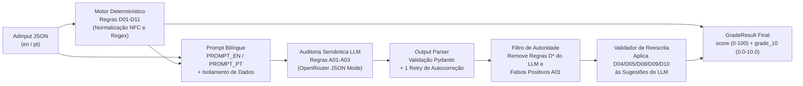

# Ad Copy Grader — Auditor Híbrido de Anúncios Google Ads (RSA)

> **[🇺🇸 English](README.md) | [🇧🇷 Português](README.pt-BR.md)**

Serviço *stateless* em **FastAPI + Pydantic v2** e playground web interativo para auditoria de **Anúncios Responsivos de Pesquisa (RSA) do Google Ads**, combinando **regras determinísticas de código + avaliação semântica via LLM**. Contagens exatas de caracteres, limites estruturais e padrões editoriais (`D01–D11`) são validados em código Python determinístico, enquanto o cruzamento semântico com a Landing Page (`A01–A03`) é julgado por um LLM (`google/gemini-2.5-flash` via OpenRouter) e pós-filtrado por um **Filtro de Autoridade do Código** no servidor, que bloqueia alucinações do modelo e valida cada sugestão de reescrita antes de retornar uma **Nota de Qualidade de 0.0 a 10.0 (`grade_10`)**.

---

## Links e Documentação

- **Web Playground Interativo (GitHub Pages):** `https://fgm9000.github.io/ad-copy-grader/` *(ou abra `web/index.html` localmente)*
- **API Cloud Run Ao Vivo & Swagger UI:** `https://ad-copy-grader-316736391681.us-central1.run.app/docs` *(a raiz `/` redireciona automaticamente para `/docs`)*
- **Documento de Requisitos de Produto (PRD):** [Português](docs/prd.pt-BR.md) | [English](docs/prd.md)
- **Guia de Arquitetura e Setup Cloud Run (WIF):** [Português](docs/architecture.pt-BR.md) | [English](docs/architecture.md)
- **Runbook de Deploy Cloud Run e Troubleshooting:** [Português](docs/deployment-runbook.pt-BR.md) | [English](docs/deployment-runbook.md)
- **Registros de Decisão de Arquitetura (ADRs):**
  - [ADR-001: Python 3.12, FastAPI, Pydantic v2 e `uv`](docs/decisions/001-python-fastapi-pydantic-v2.pt-BR.md) ([EN](docs/decisions/001-python-fastapi-pydantic-v2.md))
  - [ADR-002: Pipeline Híbrido com Autoridade Determinística sobre o LLM](docs/decisions/002-hybrid-deterministic-llm-authority.pt-BR.md) ([EN](docs/decisions/002-hybrid-deterministic-llm-authority.md))
  - [ADR-003: Cloud Run Single-Instance (`max-instances=1`) e Deploy Keyless via WIF](docs/decisions/003-cloud-run-single-instance-wif.pt-BR.md) ([EN](docs/decisions/003-cloud-run-single-instance-wif.md))
  - [ADR-004: Avaliação em 3 Colunas com Promptfoo](docs/decisions/004-three-column-promptfoo-evals.pt-BR.md) ([EN](docs/decisions/004-three-column-promptfoo-evals.md))
  - [ADR-005: Playground Estático com Tailwind CSS Pré-Compilado](docs/decisions/005-zero-runtime-tailwind-static-demo.pt-BR.md) ([EN](docs/decisions/005-zero-runtime-tailwind-static-demo.md))

---

## Arquitetura do Pipeline Híbrido



1. **Código Determinístico Primeiro (`rules.py`):** Avalia 11 regras estruturais e editoriais exatas (`D01–D11`) sobre strings normalizadas em Unicode NFC. LLMs erram contagens de caracteres (`30` em títulos, `90` em descrições, `15` em paths); código Python tem precisão de 100%.
2. **Auditoria Semântica Bilíngue (`prompt.py`, `llm.py`, `parser.py`):** Seleciona o prompt nativo (`PROMPT_EN` ou `PROMPT_PT`), isola o anúncio em tags `<ad_payload>` como dado não-confiável (defesa contra *prompt injection*) e valida a resposta com Pydantic, realizando até 1 nova tentativa automática com o erro de schema caso o JSON venha incompleto.
3. **Filtro de Autoridade do Servidor (`pipeline.py`):**
   - Descarta qualquer regra de prefixo `D*` emitida pelo LLM (impedindo duplicidade ou alucinação de tamanho).
   - Descarta localizações de campos com índices fora dos limites do anúncio.
   - Suprime falsos positivos de `A01` quando o preço/desconto apontado (ex.: `R$ 390` ou `$899`) ou CTA genérico de agendamento está comprovadamente presente em `lp_context`.
4. **Validação de Sugestões de Reescrita (`rewrite.py`):** Cada sugestão de título ou descrição gerada pelo LLM passa pelas regras determinísticas (`D04`, `D05`, `D08`, `D09`, `D10`). Sugestões que estouram o limite de caracteres são descartadas e contabilizadas em `discarded_suggestions_count`.
5. **Degradação Elegante (*Graceful Degradation*):** Se o LLM sofrer timeout ou falhar nas duas tentativas, o endpoint `/v1/grade` responde `HTTP 200` (salvo quando `strict_llm=true`) com o resultado determinístico (`D01–D11`), `model: null` e `degraded_reason` no idioma solicitado.

---

## Catálogo de Regras (`D01–D11` e `A01–A03`)

| ID | Regra | Autoridade | Severidade | Impacto |
| :--- | :--- | :--- | :--- | :--- |
| **`D01`** | Quantidade de títulos `< 3` ou `> 15` | Código Determinístico | `error` | `-15 pts` |
| **`D02`** | Quantidade de descrições `< 2` ou `> 4` | Código Determinístico | `error` | `-15 pts` |
| **`D03`** | Título ou descrição vazia (ou apenas espaços) | Código Determinístico | `error` | `-15 pts` |
| **`D04`** | Título com mais de `30` caracteres (NFC) | Código Determinístico | `error` | `-15 pts` |
| **`D05`** | Descrição com mais de `90` caracteres (NFC) | Código Determinístico | `error` | `-15 pts` |
| **`D06`** | `path1` ou `path2` com mais de `15` caracteres | Código Determinístico | `error` | `-15 pts` |
| **`D07`** | `final_url` não inicia com `https://` | Código Determinístico | `error` | `-15 pts` |
| **`D08`** | Títulos ou descrições duplicadas (normalizadas) | Código Determinístico | `error` | `-15 pts` |
| **`D09`** | Pontuação proibida (`!!`, `??`, `!...`) ou `!` em título | Código Determinístico | `error` | `-15 pts` |
| **`D10`** | Palavra em CAIXA ALTA (`>= 4` letras, fora da lista de siglas) | Código Determinístico | `warning` | `-5 pts` |
| **`D11`** | Serviço principal (`primary_service`) ausente de todos os títulos | Código Determinístico | `warning` | `-5 pts` |
| **`A01`** | Preço, desconto ou condição concreta ausente do `lp_context` | LLM + Filtro de Código | `error` | `-15 pts` |
| **`A02`** | Nenhuma descrição possui chamada para ação (CTA) clara | LLM + Filtro de Código | `warning` | `-5 pts` |
| **`A03`** | Promessa clínica/financeira absoluta (ex.: `"resultado 100% garantido"`) | LLM + Filtro de Código | `warning` | `-5 pts` |

**Fórmula de Pontuação:**
- `score = max(0, 100 - 15 * errors - 5 * warnings)` (`0` a `100`)
- `grade_10 = round(score / 10, 1)` (`0.0` a `10.0`, alinhada ao *Quality Score* do Google Ads)
- `passed = (errors == 0)`

---

## Avaliação em 3 Colunas com Promptfoo (`evals/`)

A suíte em [`evals/`](evals/) compara três colunas lado a lado em **16 cenários bilíngues de mutação única** (8 em inglês e 8 em português):

| Coluna | Modo do Provider | Objetivo | CI Offline (`FAKE_MODEL=1`) |
| :--- | :--- | :--- | :--- |
| **1. Raw LLM** | `mode: raw` | Saída crua do modelo antes das regras de código e do filtro de autoridade | **16 / 16 (100%)** |
| **2. Production Hybrid Pipeline** | `mode: pipeline` | Pipeline completo de produção (`D01–D11` + `A01–A03` + Filtro de Autoridade + Validador de Reescrita) | **16 / 16 (100%)** |
| **3. Degraded Prompt** | `mode: degraded` | Baseline de ablação sem a instrução que proíbe o LLM de apontar regras `D*` | Demonstra invasão de `D04` sem o guardrail |

---

## Catraca de Qualidade e Gates de Segurança (AppSec)

Todo push e pull request passa por [`.github/workflows/ci.yml`](.github/workflows/ci.yml) e [`.github/workflows/codeql.yml`](.github/workflows/codeql.yml):

| Gate | Ferramenta | Baseline Atual ([`quality-baseline.json`](quality-baseline.json)) |
| :--- | :--- | :--- |
| **Lint & Formatação** | `ruff check .` + `ruff format --check .` (`E,F,I,B,UP,S,N,SIM`) | `0` problemas |
| **Tipagem Estática Estrita** | `mypy --strict` | `0` erros |
| **Testes Unitários e Integração** | `pytest --cov=ad_copy_grader` | `123` passando, `0` pulados, **`99.1%`** cobertura |
| **Catraca Zero-Supressão** | `scripts/quality_check.py` (`# noqa`, `# type: ignore`, `pragma: no cover`) | `0` supressões |
| **SAST (OWASP Top 10 & FastAPI)** | `semgrep scan --config p/owasp-top-ten --config p/python --config p/fastapi --error` | Gate bloqueante na CI |
| **Análise Semântica de Fluxo (Taint)** | GitHub CodeQL (`security-extended,security-and-quality`) | Ativo em `push`, `PR` e cron semanal |
| **Varredura de Segredos** | `gitleaks` (histórico completo + hook `pre-commit`) | `0` vazamentos |
| **Auditoria de Dependências (SCA)** | `pip-audit` + Dependabot semanal | Monitorado na CI |

---

## Como Executar Localmente

### Pré-requisitos
- **Python 3.12+** e **[`uv`](https://docs.astral.sh/uv/)**
- **Node.js 20+** *(opcional, necessário apenas para rodar a CLI do Promptfoo)*

### 1. Instalar Dependências e Hooks Git
```bash
uv sync --frozen
git config core.hooksPath .githooks
```

### 2. Rodar Testes, Tipagem, Linter e Catraca de Qualidade
```bash
uv run ruff check .
uv run ruff format --check .
uv run mypy
uv run pytest --cov=ad_copy_grader --cov-report=term-missing
uv run python scripts/quality_check.py
```

### 3. Rodar a Suíte de Avaliação de 3 Colunas (Promptfoo)
```bash
# Avaliação determinística offline de CI (custo zero, sem necessidade de chave de API):
FAKE_MODEL=1 uv run npx --yes promptfoo@0.109.0 eval -c evals/promptfooconfig.yaml --no-cache

# Avaliação ao vivo com OpenRouter:
OPENROUTER_API_KEY="sk-or-v1-..." LLM_MODEL="google/gemini-2.5-flash" \
  uv run npx --yes promptfoo@0.109.0 eval -c evals/promptfooconfig.yaml --no-cache
```

### 4. Subir a API FastAPI e o Web Playground
```bash
# Iniciar em modo FakeModel offline (ou defina OPENROUTER_API_KEY no .env para chamadas reais):
FAKE_MODEL=true uv run uvicorn ad_copy_grader.api:app --reload --port 8000
```
Acesse `http://localhost:8000/docs` para a documentação interativa OpenAPI ou sirva a pasta `web/` (`python -m http.server 3000 -d web`) em `http://localhost:3000` para usar o playground bilíngue lado a lado.

---

## Licença

Copyright (c) 2026 Fabio Moura. Licenciado sob a **[PolyForm Noncommercial License 1.0.0](LICENSE)** (livre para leitura, estudo e avaliação de portfólio sem fins comerciais; uso comercial é estritamente proibido).
