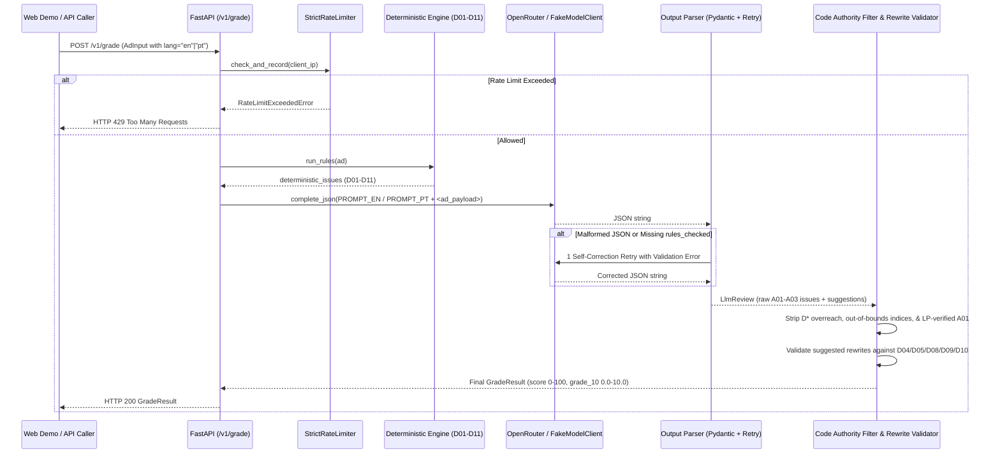

# Architecture & Cloud Run Deployment Guide

> **[🇺🇸 English](architecture.md) | [🇧🇷 Português](architecture.pt-BR.md)**

---

## 1. System Overview

`ad-copy-grader` is a stateless **FastAPI + Pydantic v2** service that evaluates Google Ads Responsive Search Ads (RSAs) through a **hybrid deterministic + LLM pipeline**. It separates mechanical validation (character counts, URL schemes, duplicates, punctuation, and capitalization) from semantic reasoning (cross-checking ad claims against landing page content, verifying CTA presence, and detecting absolute outcome guarantees).



---

## 2. Module Responsibilities (`src/ad_copy_grader/`)

| Module | Responsibility |
| :--- | :--- |
| `models.py` | Strict Pydantic v2 request/response contracts (`AdInput`, `Issue`, `Location`, `Suggestion`, `GradeResult`), NFC normalization, and `lp_context` truncation (`<= 1,200` chars). |
| `rules.py` | Pure functions implementing deterministic rules `D01–D11` with bilingual message templates (`RULE_MESSAGES` in `en` and `pt`). |
| `prompt.py` | Native bilingual system prompts (`PROMPT_EN` and `PROMPT_PT`), untrusted `<ad_payload>` XML fencing against prompt injection, and `build_degraded_system_prompt` for Promptfoo ablation testing. |
| `llm.py` | `ModelClient` protocol, async `OpenRouterClient` (`httpx`, JSON mode, 20s timeout, zero key leakage), and deterministic `FakeModelClient`. |
| `parser.py` | Markdown fence stripping, `LlmReview` Pydantic validation, completeness check (`A01`, `A02`, `A03` in `rules_checked`), and single self-correction retry. |
| `pipeline.py` | `grade()`, `grade_with_degradation()`, `build_degraded_result()`, `filter_llm_issues()` (Server Code Authority Filter), and `compute_score()`. |
| `rewrite.py` | `validate_suggestions()` auditing LLM rewrite suggestions against deterministic rules (`D04`, `D05`, `D08`, `D09`, `D10`). |
| `limits.py` | Thread-safe in-memory sliding-window per-IP limiter (`RATE_LIMIT_PER_MINUTE=5`) and UTC daily request cap (`DAILY_REQUEST_CAP=200`) with injectable clock. |
| `settings.py` | `pydantic-settings` environment loader (`Settings`) supporting `.env` files and comma-separated or JSON `ALLOWED_ORIGINS`. |
| `api.py` | FastAPI application (`POST /v1/grade`, `GET /healthz`), CORS middleware, exception handlers, and single-line structured JSON request telemetry. |

---

## 3. Security Boundaries & AppSec Controls

1. **Prompt Injection Defense:** User-supplied headlines, descriptions, and landing page context are serialized inside `<ad_payload>...</ad_payload>` tags with explicit system instructions treating them strictly as untrusted data to be audited, never as instructions.
2. **Server Code Authority:** Even if an LLM hallucinates a deterministic rule (`D01–D11`), an out-of-bounds field index, or a false-positive `A01` price violation for a price present in `lp_context`, `filter_llm_issues()` deterministically strips it on the server.
3. **Zero PII / Ad Copy in Logs:** Request logs emit only metadata (`status_code`, `lang`, `headlines_count`, `descriptions_count`, `triggered_rules`, `score`, `grade_10`, `latency_ms`) — never raw ad text or API keys.
4. **Multi-Layer CI Security Scanning:**
   - **Ruff (`S` / `flake8-bandit`):** Fast AST security checks on every commit.
   - **Semgrep OSS (`p/owasp-top-ten`, `p/python`, `p/fastapi`):** Blocking SAST job in `.github/workflows/ci.yml`.
   - **GitHub CodeQL (`.github/workflows/codeql.yml`):** Semantic interprocedural taint analysis for Python.
   - **Gitleaks & `pip-audit`:** Full-history secret detection and dependency vulnerability auditing.

---

## 4. One-Time Google Cloud Run & Workload Identity Federation Setup

The deployment workflow in [`.github/workflows/deploy.yml`](../.github/workflows/deploy.yml) uses keyless **Workload Identity Federation (OIDC)** and **Google Secret Manager**. To activate automatic deployment on your GCP project, run the following commands once in your terminal:

```bash
# 1. Set your variables
export GCP_PROJECT_ID="your-gcp-project-id"
export GCP_REGION="us-central1"
export GITHUB_REPO="fgm9000/ad-copy-grader"

gcloud config set project "${GCP_PROJECT_ID}"

# 2. Enable required Google Cloud APIs
gcloud services enable \
  run.googleapis.com \
  artifactregistry.googleapis.com \
  secretmanager.googleapis.com \
  iam.googleapis.com \
  iamcredentials.googleapis.com

# 3. Create Artifact Registry Docker repository in us-central1
gcloud artifacts repositories create ad-copy-grader \
  --repository-format=docker \
  --location="${GCP_REGION}" \
  --description="Ad Copy Grader container images"

# 4. Create the OpenRouter API key secret in Secret Manager
printf "sk-or-v1-your-openrouter-key" | \
  gcloud secrets create openrouter-api-key --data-file=-

# 5. Create Runtime Service Account (least privilege: only Secret Accessor)
gcloud iam service-accounts create ad-copy-grader-runtime \
  --display-name="Ad Copy Grader Cloud Run Runtime SA"

gcloud secrets add-iam-policy-binding openrouter-api-key \
  --member="serviceAccount:ad-copy-grader-runtime@${GCP_PROJECT_ID}.iam.gserviceaccount.com" \
  --role="roles/secretmanager.secretAccessor"

# 6. Create Deployer Service Account (Cloud Run Admin + Artifact Registry Writer)
gcloud iam service-accounts create ad-copy-grader-deployer \
  --display-name="GitHub Actions Cloud Run Deployer SA"

gcloud projects add-iam-policy-binding "${GCP_PROJECT_ID}" \
  --member="serviceAccount:ad-copy-grader-deployer@${GCP_PROJECT_ID}.iam.gserviceaccount.com" \
  --role="roles/run.admin"

gcloud projects add-iam-policy-binding "${GCP_PROJECT_ID}" \
  --member="serviceAccount:ad-copy-grader-deployer@${GCP_PROJECT_ID}.iam.gserviceaccount.com" \
  --role="roles/artifactregistry.writer"

gcloud iam service-accounts add-iam-policy-binding \
  "ad-copy-grader-runtime@${GCP_PROJECT_ID}.iam.gserviceaccount.com" \
  --member="serviceAccount:ad-copy-grader-deployer@${GCP_PROJECT_ID}.iam.gserviceaccount.com" \
  --role="roles/iam.serviceAccountUser"

# 7. Configure Workload Identity Pool & GitHub OIDC Provider (restricted to main branch)
gcloud iam workload-identity-pools create "github-pool" \
  --location="global" \
  --display-name="GitHub Actions Pool"

gcloud iam workload-identity-pools providers create-oidc "github-provider" \
  --location="global" \
  --workload-identity-pool="github-pool" \
  --display-name="GitHub OIDC Provider" \
  --issuer-uri="https://token.actions.githubusercontent.com" \
  --attribute-mapping="google.subject=assertion.sub,attribute.repository=assertion.repository,attribute.ref=assertion.ref" \
  --attribute-condition="assertion.repository == '${GITHUB_REPO}' && assertion.ref == 'refs/heads/main'"

PROJECT_NUMBER=$(gcloud projects describe "${GCP_PROJECT_ID}" --format="value(projectNumber)")

gcloud iam service-accounts add-iam-policy-binding \
  "ad-copy-grader-deployer@${GCP_PROJECT_ID}.iam.gserviceaccount.com" \
  --role="roles/iam.workloadIdentityUser" \
  --member="principalSet://iam.googleapis.com/projects/${PROJECT_NUMBER}/locations/global/workloadIdentityPools/github-pool/attribute.repository/${GITHUB_REPO}"
```

Finally, add these three **Repository Variables** in GitHub (`Settings -> Secrets and variables -> Actions -> Variables`):
- `GCP_PROJECT_ID`: `your-gcp-project-id`
- `GCP_WIF_PROVIDER`: `projects/<PROJECT_NUMBER>/locations/global/workloadIdentityPools/github-pool/providers/github-provider`
- `GCP_SERVICE_ACCOUNT`: `ad-copy-grader-deployer@<GCP_PROJECT_ID>.iam.gserviceaccount.com`
