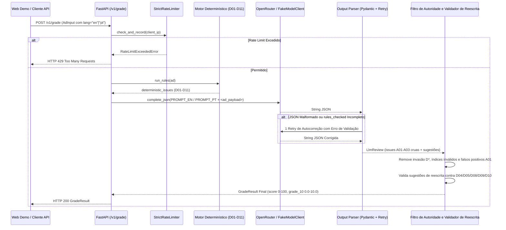

# Guia de Arquitetura e Deploy no Cloud Run

> **[🇺🇸 English](architecture.md) | [🇧🇷 Português](architecture.pt-BR.md)**
>
> **Veja também:** [Runbook Passo a Passo de Deploy no Cloud Run e Troubleshooting](deployment-runbook.pt-BR.md)

---

## 1. Visão Geral do Sistema

O `ad-copy-grader` é um serviço *stateless* em **FastAPI + Pydantic v2** que audita Anúncios Responsivos de Pesquisa (RSAs) do Google Ads por meio de um **pipeline híbrido determinístico + LLM**. Ele separa validações mecânicas exatas (contagem de caracteres, esquema de URL, duplicatas, pontuação e caixa alta) do julgamento semântico (cruzamento de ofertas com o texto da Landing Page, presença de CTA e detecção de promessas absolutas).



---

## 2. Responsabilidades dos Módulos (`src/ad_copy_grader/`)

| Módulo | Responsabilidade |
| :--- | :--- |
| `models.py` | Contratos estritos Pydantic v2 (`AdInput`, `Issue`, `Location`, `Suggestion`, `GradeResult`), normalização NFC e truncamento de `lp_context` (`<= 1.200` caracteres). |
| `rules.py` | Funções puras implementando as regras determinísticas `D01–D11` com mensagens bilíngues (`RULE_MESSAGES` em `en` e `pt`). |
| `prompt.py` | Prompts de sistema nativos nos dois idiomas (`PROMPT_EN` e `PROMPT_PT`), isolamento de dados não-confiáveis em `<ad_payload>` e `build_degraded_system_prompt` para ablação no Promptfoo. |
| `llm.py` | Protocolo `ModelClient`, cliente assíncrono `OpenRouterClient` (`httpx`, modo JSON, timeout de 20s, zero vazamento de chave) e `FakeModelClient` determinístico. |
| `parser.py` | Limpeza de cercas Markdown, validação Pydantic `LlmReview`, checagem de completude (`A01`, `A02`, `A03` em `rules_checked`) e 1 retry de autocorreção. |
| `pipeline.py` | `grade()`, `grade_with_degradation()`, `build_degraded_result()`, `filter_llm_issues()` (Filtro de Autoridade do Código) e `compute_score()`. |
| `rewrite.py` | `validate_suggestions()` auditando cada sugestão de reescrita do LLM contra as regras determinísticas (`D04`, `D05`, `D08`, `D09`, `D10`). |
| `limits.py` | Limitador *thread-safe* em memória por IP com janela deslizante (`RATE_LIMIT_PER_MINUTE=5`) e teto diário UTC (`DAILY_REQUEST_CAP=200`) com relógio injetável. |
| `settings.py` | Carregador de ambiente `pydantic-settings` (`Settings`) com suporte a `.env` e `ALLOWED_ORIGINS` em lista CSV ou JSON. |
| `api.py` | Aplicação FastAPI (`POST /v1/grade`, `GET /healthz`), middleware CORS, tratamento de exceções e telemetria estruturada em JSON de linha única. |

---

## 3. Fronteiras de Segurança e Controles AppSec

1. **Defesa contra Prompt Injection:** Títulos, descrições e contexto da Landing Page enviados pelo usuário são encapsulados em tags `<ad_payload>...</ad_payload>` com instruções explícitas no prompt tratando o conteúdo como dado não-confiável a ser auditado, jamais como comando.
2. **Autoridade do Código no Servidor:** Mesmo que um LLM alucine uma regra determinística (`D01–D11`), um índice fora dos limites do anúncio ou um falso positivo de `A01` para um preço que consta no `lp_context`, `filter_llm_issues()` descarta o apontamento de forma determinística no servidor.
3. **Zero PII / Texto de Anúncio em Logs:** Os logs registram apenas metadados (`status_code`, `lang`, `headlines_count`, `descriptions_count`, `triggered_rules`, `score`, `grade_10`, `latency_ms`) — nunca o texto do anúncio nem chaves de API.
4. **Varredura de Segurança em Múltiplas Camadas na CI:**
   - **Ruff (`S` / `flake8-bandit`):** Checagem rápida de AST em todo commit.
   - **Semgrep OSS (`p/owasp-top-ten`, `p/python`, `p/fastapi`):** Job bloqueante de SAST em `.github/workflows/ci.yml`.
   - **GitHub CodeQL (`.github/workflows/codeql.yml`):** Análise semântica interprocedural de fluxo de dados (*taint tracking*) para Python.
   - **Gitleaks & `pip-audit`:** Detecção de segredos em todo o histórico Git e auditoria de CVEs em dependências.

---

## 4. Setup Único do Google Cloud Run e Workload Identity Federation

O workflow de deploy em [`.github/workflows/deploy.yml`](../.github/workflows/deploy.yml) utiliza **Workload Identity Federation (OIDC sem chaves estáticas)** e **Google Secret Manager**. Para ativar o deploy automático no seu projeto GCP, execute os comandos abaixo uma única vez no terminal:

```bash
# 1. Defina as variáveis do seu ambiente
export GCP_PROJECT_ID="seu-gcp-project-id"
export GCP_REGION="us-central1"
export GITHUB_REPO="fgm9000/ad-copy-grader"

gcloud config set project "${GCP_PROJECT_ID}"

# 2. Ative as APIs necessárias no Google Cloud
gcloud services enable \
  run.googleapis.com \
  artifactregistry.googleapis.com \
  secretmanager.googleapis.com \
  iam.googleapis.com \
  iamcredentials.googleapis.com

# 3. Crie o repositório Docker no Artifact Registry em us-central1
gcloud artifacts repositories create ad-copy-grader \
  --repository-format=docker \
  --location="${GCP_REGION}" \
  --description="Ad Copy Grader container images"

# 4. Crie o segredo da chave OpenRouter no Secret Manager
printf "sk-or-v1-sua-chave-openrouter" | \
  gcloud secrets create openrouter-api-key --data-file=-

# 5. Crie a Service Account de Runtime (menor privilégio: apenas Secret Accessor)
gcloud iam service-accounts create ad-copy-grader-runtime \
  --display-name="Ad Copy Grader Cloud Run Runtime SA"

gcloud secrets add-iam-policy-binding openrouter-api-key \
  --member="serviceAccount:ad-copy-grader-runtime@${GCP_PROJECT_ID}.iam.gserviceaccount.com" \
  --role="roles/secretmanager.secretAccessor"

# 6. Crie a Service Account de Deploy (Cloud Run Admin + Artifact Registry Writer)
gcloud iam service-accounts create ad-copy-grader-deployer \
  --display-name="GitHub Actions Cloud Run Deployer SA"

gcloud projects add-iam-policy-binding "${GCP_PROJECT_ID}" \
  --member="serviceAccount:ad-copy-grader-deployer@${GCP_PROJECT_ID}.iam.gserviceaccount.com" \
  --role="roles/run.admin"

gcloud projects add-iam-policy-binding "${GCP_PROJECT_ID}" \
  --member="serviceAccount:ad-copy-grader-deployer@${GCP_PROJECT_ID}.iam.gserviceaccount.com" \
  --role="roles/artifactregistry.writer"

gcloud iam service-accounts add-iam-policy-binding \
  "ad-copy-grader-runtime@${GCP_PROJECT_ID}.iam.gserviceaccount.com" \
  --member="serviceAccount:ad-copy-grader-deployer@${GCP_PROJECT_ID}.iam.gserviceaccount.com" \
  --role="roles/iam.serviceAccountUser"

# 7. Configure o Workload Identity Pool e o Provider OIDC do GitHub (restrito à branch main)
gcloud iam workload-identity-pools create "github-pool" \
  --location="global" \
  --display-name="GitHub Actions Pool"

gcloud iam workload-identity-pools providers create-oidc "github-provider" \
  --location="global" \
  --workload-identity-pool="github-pool" \
  --display-name="GitHub OIDC Provider" \
  --issuer-uri="https://token.actions.githubusercontent.com" \
  --attribute-mapping="google.subject=assertion.sub,attribute.repository=assertion.repository,attribute.ref=assertion.ref" \
  --attribute-condition="assertion.repository == '${GITHUB_REPO}' && assertion.ref == 'refs/heads/main'"

PROJECT_NUMBER=$(gcloud projects describe "${GCP_PROJECT_ID}" --format="value(projectNumber)")

gcloud iam service-accounts add-iam-policy-binding \
  "ad-copy-grader-deployer@${GCP_PROJECT_ID}.iam.gserviceaccount.com" \
  --role="roles/iam.workloadIdentityUser" \
  --member="principalSet://iam.googleapis.com/projects/${PROJECT_NUMBER}/locations/global/workloadIdentityPools/github-pool/attribute.repository/${GITHUB_REPO}"
```

Por fim, cadastre estas três **Repository Variables** no GitHub (`Settings -> Secrets and variables -> Actions -> Variables`):
- `GCP_PROJECT_ID`: `seu-gcp-project-id`
- `GCP_WIF_PROVIDER`: `projects/<PROJECT_NUMBER>/locations/global/workloadIdentityPools/github-pool/providers/github-provider`
- `GCP_SERVICE_ACCOUNT`: `ad-copy-grader-deployer@<GCP_PROJECT_ID>.iam.gserviceaccount.com`
